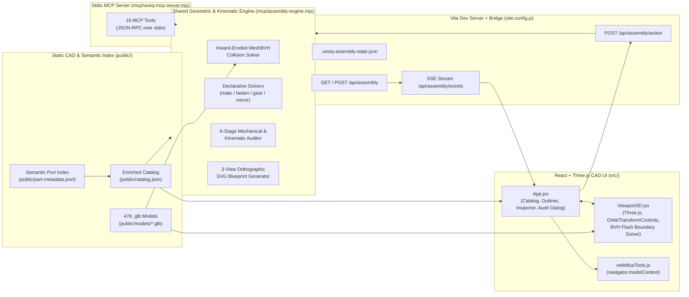

# VEX IQ 3D Robot Modeler — Architecture & Detailed Design (`design.md`)

> **Last Updated:** 2026-10-23  
> **Scope:** System architecture, coordinate conventions, data schemas, BVH collision & flush-boundary math, declarative mating solvers, 6-stage mechanical audit algorithms, and real-time MCP synchronization.

---

## 1. System Architecture Overview

The VEX IQ 3D Robot Modeler is a hybrid **Interactive 3D CAD Web Application** + **Headless Node.js Geometric Assembly Engine** that share a single source of truth for part geometry, semantic connection ports, and assembly state.

---

## 2. Directory & Module Structure

| Path | Responsibility |
| :--- | :--- |
| [`public/catalog.json`](file:///Users/adriangonsalves/projects/vexiq_builder/public/catalog.json) | Master catalog of 478 VEX IQ parts enriched with bounding boxes, `pitchSize`, `originType`, `gearSpecs`, `fastenerSpecs`, `mountingRules`, and `ports[]` (`4,137` verified semantic ports). |
| [`public/part-metadata.json`](file:///Users/adriangonsalves/projects/vexiq_builder/public/part-metadata.json) | Standalone semantic port & mechanical metadata index generated by the offline indexer. |
| [`public/models/*.glb`](file:///Users/adriangonsalves/projects/vexiq_builder/public/models) | Binary glTF 2.0 triangle meshes converted from official VEX IQ STEP files, centered at `[0, 0, 0]` in millimeters. |
| [`public/assembly-blueprint.svg`](file:///Users/adriangonsalves/projects/vexiq_builder/public/assembly-blueprint.svg) | Generated 3-view (`TOP X–Z`, `SIDE X–Y`, `FRONT Z–Y`) orthographic engineering blueprint. |
| [`scripts/build-catalog.mjs`](file:///Users/adriangonsalves/projects/vexiq_builder/scripts/build-catalog.mjs) | STEP + GLB ingestion script that extracts bounding boxes, cylindrical hole axes, and categories. |
| [`scripts/index-part-metadata.mjs`](file:///Users/adriangonsalves/projects/vexiq_builder/scripts/index-part-metadata.mjs) | 478-part BVH raycast & cross-section analyzer that classifies ports (`pin_hole`, `shaft_bore`, `shaft_socket`, `pin_peg`) and fastener/gear specs. |
| [`mcp/assembly-engine.mjs`](file:///Users/adriangonsalves/projects/vexiq_builder/mcp/assembly-engine.mjs) | Core geometric engine: MeshBVH collision checking, `mateParts`, `autoFastenJoint`, `meshGearTrain`, `mirrorSubassembly`, 6-stage `auditAssembly`, and `generateOrthographicViews`. |
| [`mcp/vexiq-mcp-server.mjs`](file:///Users/adriangonsalves/projects/vexiq_builder/mcp/vexiq-mcp-server.mjs) | Model Context Protocol (MCP) stdio server exposing 16 tools to AI coding/design agents. |
| [`vite.config.js`](file:///Users/adriangonsalves/projects/vexiq_builder/vite.config.js) | Custom Vite plugin `vexIqMcpBridgePlugin()` providing `/api/assembly`, `/api/assembly/events` (SSE), and `/api/assembly/action`. |
| [`src/App.jsx`](file:///Users/adriangonsalves/projects/vexiq_builder/src/App.jsx) | Main 3-column CAD UI: Part Library, 3D Viewport container & HUD, Scene Outliner, Precision Inspector, Smart Assembly card, and Audit & Blueprint `<dialog>`. |
| [`src/components/Viewport3D.jsx`](file:///Users/adriangonsalves/projects/vexiq_builder/src/components/Viewport3D.jsx) | Three.js WebGL scene, `OrbitControls`, `TransformControls`, BVH Flush Contact Boundary solver, Explode View engine, and Semantic Port 3D overlays. |
| [`src/utils/pinHoleAlignment.js`](file:///Users/adriangonsalves/projects/vexiq_builder/src/utils/pinHoleAlignment.js) | Pure pin/shaft-to-opening alignment math (`collectWorldFeatures`, `findAlignedOpenings`) used by the viewport's aligned-hole highlights; checked from Node by [`scripts/check-pin-hole-alignment.mjs`](file:///Users/adriangonsalves/projects/vexiq_builder/scripts/check-pin-hole-alignment.mjs). |
| [`src/utils/geometryCache.js`](file:///Users/adriangonsalves/projects/vexiq_builder/src/utils/geometryCache.js) | Singleton `.glb` loader and inward-eroded (`0.38 mm`) `MeshBVH` builder shared across viewport instances and thumbnails. |
| [`src/components/PartThumbnail.jsx`](file:///Users/adriangonsalves/projects/vexiq_builder/src/components/PartThumbnail.jsx) | Shared offscreen WebGL renderer that rasterizes and caches 2D data-URL thumbnails for catalog cards. |
| [`src/utils/webMcpTools.js`](file:///Users/adriangonsalves/projects/vexiq_builder/src/utils/webMcpTools.js) | W3C WebMCP (`navigator.modelContext`) tool registration for in-browser AI agents. |
| [`openspec/`](file:///Users/adriangonsalves/projects/vexiq_builder/openspec) | Spec-Driven Development (SDD) workspace containing living specs (`openspec/specs/`), active change proposals (`openspec/changes/`), and workflow configuration (`openspec/config.yaml`). |
| [`.agents/`](file:///Users/adriangonsalves/projects/vexiq_builder/.agents) | Antigravity AI workflow definitions (`.agents/workflows/opsx-*.md`), agent skills (`.agents/skills/`), MCP configuration, and repository rules. |

---

## 3. Coordinate System & VEX Pitch Conventions

1. **Units & Pitch Constant:**
   - All 3D coordinates are stored in **millimeters (`mm`)**.
   - **1x VEX IQ Pitch (`1P`)** = $0.5\text{ in} = 12.7\text{ mm}$.
   - **0.5x Pitch (`0.5P`)** = $6.35\text{ mm}$ (standard thickness of a `1x` beam/plate wall and spacing from beam centerline to hole row).
   - **0.25x Pitch (`0.25P`)** = $3.175\text{ mm}$ (half-wall thickness from the center plane of a standard beam/plate to its outer mounting face).
2. **Part Local Coordinate Frame:**
   - Every `.glb` mesh in `public/models/` has its bounding-box center normalized to local origin `[0, 0, 0]`.
   - Standard structural beams lie along the **local `X` axis** (length), with hole rows along **local `Y`** ($\pm 6.35\text{ mm}$ for `2x` beams) and pin hole axes pointing along **local `Z`** (`[0, 0, 1]`, wall spanning $z \in [-3.05, +3.05]\text{ mm}$).
   - Standard pins, standoffs, shafts, gears, and wheels have their primary rotational/insertion axis along **local `Z`** (`[0, 0, 1]`).
3. **World Transform Composition:**
   - Each placed instance stores `position: [x, y, z]` (in `mm`) and intrinsic Euler `rotation: [rx, ry, rz]` (in degrees, order `'XYZ'`).
   - World matrix:
     $$M_{\text{world}} = T(x, y, z) \cdot R_X(r_x) \cdot R_Y(r_y) \cdot R_Z(r_z)$$

---

## 4. Semantic Port Indexing Pipeline ([`scripts/index-part-metadata.mjs`](file:///Users/adriangonsalves/projects/vexiq_builder/scripts/index-part-metadata.mjs))

During offline indexing across all 478 `.glb` + `.step` files:

1. **Candidate Axis Extraction:**
   - Parses STEP `CYLINDRICAL_SURFACE` entities (`AXIS2_PLACEMENT_3D` + radius) and deduplicates coaxial cylinders into candidate axes.
   - Synthesizes fallback grid axes for square-bore gears, wheels, motors, and plates whose bores are represented by planar/B-spline faces in STEP.
2. **BVH Raycast & Radial Cross-Section Classification:**
   - Casts axial rays along each candidate axis and 16 radial rays perpendicular to the axis against the `MeshBVH` of the part:
     - **`pin_hole`**: Open axial bore with radial wall hits at $r \in [2.1, 2.6]\text{ mm}$ ($\varnothing 4.8\text{ mm}$ VEX pin hole). Records exact wall entry/exit `spanMm: [tMin, tMax]` and `through: boolean`.
     - **`shaft_bore`**: Square or round bore on gears, wheels, sprockets, pulleys, and collars with minimum wall radius $r \in [1.4, 2.3]\text{ mm}$.
     - **`shaft_socket`**: Blind square drive socket on Smart Motors and electronics (`through: false`, depth $\approx 9.5\text{ mm}$).
     - **`pin_peg`**: External cylindrical peg on Connector Pins and Standoffs. Measures radial cross-sections along local $Z$ to locate the central retention flange (`shoulderZ`) or end cap (`hasEndCap`), storing `sideNegZ_mm` and `sidePosZ_mm` in `fastenerSpecs`.

---

## 5. Concave BVH Collision & Physical Flush Contact Boundary Solver

### 5.1 Inward-Eroded Collision Geometry (`clearanceMm = 0.38 mm`)
VEX IQ connector pins have snap ridges ($r \approx 2.35\text{ mm}$) that interference-fit inside beam holes ($r \approx 2.10\text{–}2.40\text{ mm}$), and meshed gears have slight tooth-tip tolerances. To allow valid pin-in-hole and gear-mesh engagements while catching real solid-body collisions:
- Both [`src/utils/geometryCache.js`](file:///Users/adriangonsalves/projects/vexiq_builder/src/utils/geometryCache.js) (browser) and [`mcp/assembly-engine.mjs`](file:///Users/adriangonsalves/projects/vexiq_builder/mcp/assembly-engine.mjs) (Node) weld vertex normals by spatial hash (`0.01 mm` tolerance) and erode every vertex inward by $\delta = 0.38\text{ mm}$:
  $$\mathbf{v}_{\text{col}} = \mathbf{v} - 0.38 \cdot \hat{\mathbf{n}}_{\text{welded}}$$
- A `MeshBVH` acceleration tree is built on the eroded geometry, and pairwise intersections are tested via `boundsTreeA.intersectsGeometry(geoB, M_BtoA)` after a fast world AABB broadphase check.

### 5.2 Physical Flush Contact Boundary Snapping ([`Viewport3D.jsx`](file:///Users/adriangonsalves/projects/vexiq_builder/src/components/Viewport3D.jsx))
When moving a part via the 3D Move Gizmo or Inspector Nudge buttons:
- Why standard `0.5P` (`6.35 mm`) grid steps fail at plate boundaries:
  - A beam centered at $z = 0$ has its hole boss at $\pm 2.29\text{ mm}$ and outer rim at $\pm 3.05\text{ mm}$.
  - A `0x2 Connector Pin` (`228-2500-086`) has its flat cap underside at $5.46\text{ mm}$ from its origin and cap outer face at $6.26\text{ mm}$.
  - Therefore, the pin's flat cap is **100% flush** with the beam when the pin is at:
    $$z_{\text{flush}} = \pm(5.46 - 2.287) \approx \pm 3.175\text{ mm} = \pm 0.25\text{P}$$
  - Moving in `0.5P` (`6.35 mm`) increments from $0\text{ mm}$ jumps straight to $\pm 6.35\text{ mm}$ (burying the cap inside the beam wall).
- **Flush Contact Detent Algorithm (`findFlushBoundaryPosition`):**
  1. During translation, `TransformControls` raw unsnapped cursor positions $\mathbf{p}_{\text{raw}}$ are evaluated in `objectChange`.
  2. In open space, coordinates snap to world grid multiples of `snapPitchFactor * 12.7 mm`.
  3. **Quarter-Pitch (`0.25P = 3.175 mm`) Flush Seat Detection:** If the cursor is near a `0.25P` plane $q$ where the part is collision-free (`checkGroupCollision === false`) AND stepping one `0.25P` further ($q \pm 3.175\text{ mm}$) causes a collision, $q$ is recognized as a physical flush seat and snapped to directly.
  4. **10-Step BVH Bisection on Penetration:** Whenever a snapped step $\mathbf{p}_{\text{snapped}}$ collides with another part while the previous drag pose $\mathbf{p}_{\text{clear}}$ was clear (and cursor penetration distance $\le 1.35\text{P} = 17.15\text{ mm}$):
     - A 10-iteration binary search on $[\mathbf{p}_{\text{clear}}, \mathbf{p}_{\text{snapped}}]$ locates the exact non-penetrating surface boundary $\mathbf{p}_{\text{lo}}$ to within $0.006\text{ mm}$.
     - If a clean `0.25P` (`3.175 mm`) grid plane lies on the safe side within $0.95\text{ mm}$ of $\mathbf{p}_{\text{lo}}$ and is collision-free, it snaps to that exact `0.25P` coordinate; otherwise it clamps to $\mathbf{p}_{\text{lo}}$.
     - Pulling the cursor further than $1.35\text{P}$ (or out the other side into clear space) releases the detent so parts can pass through when intended.

### 5.3 Move Gizmo Plane-Drag Handles (`enhanceTranslatePlaneHandles` in [`Viewport3D.jsx`](file:///Users/adriangonsalves/projects/vexiq_builder/src/components/Viewport3D.jsx))
- Three.js `TransformControls` natively supports planar translation (`axis = 'XY' | 'YZ' | 'XZ'`): on pointer-down it orients its internal `TransformControlsPlane` with normal $\hat{\mathbf{z}}$, $\hat{\mathbf{x}}$, or $\hat{\mathbf{y}}$ respectively and projects the cursor ray onto that plane, so the offset only has components in the two plane axes.
- The stock plane squares are tiny ($0.15$ gizmo units) and faint. Because `setupGizmo()` bakes each handle's transform into its geometry, `enhanceTranslatePlaneHandles(transform)` replaces the `XY` / `YZ` / `XZ` handle geometries in both `_gizmo.gizmo.translate` (visible) and `_gizmo.picker.translate` (invisible hit area):
  - Visible squares: $0.26$ units, centered $0.27$ units out along both plane axes, `opacity 0.32`, `depthTest: false`.
  - Outline: a `LineSegments` square added with the **same handle name**, so `TransformControlsGizmo.updateMatrixWorld()` positions, scales, hides it edge-on (`PLANE_HIDE_THRESHOLD = 0.2`), and highlights it yellow alongside its fill.
  - Picker squares: enlarged to $0.32$ units for easier grabbing.
- Plane drags flow through the same `objectChange` handler as axis drags: the per-axis snap leaves the locked (normal) axis at its drag-start value, while in-plane axes get world-grid / `0.25P` flush-seat snapping and BVH bisection clamping.

### 5.4 Aligned Hole Highlighting ([`pinHoleAlignment.js`](file:///Users/adriangonsalves/projects/vexiq_builder/src/utils/pinHoleAlignment.js) + [`Viewport3D.jsx`](file:///Users/adriangonsalves/projects/vexiq_builder/src/components/Viewport3D.jsx))
- **Features per part** (`getLocalFeatures`, part-local, cached per catalog entry). Each feature is an axis line plus a usable extent $[t_{\min}, t_{\max}]$ with $t = \mathbf{p} \cdot \hat{\mathbf{a}}$ measured from the part origin (the same convention as port `spanMm`):

  | Kind | Source | Extent |
  | :--- | :--- | :--- |
  | `pin` (insert) | `ports[]` `pin_peg` | `spanMm` |
  | `shaft` (insert) | `fastenerSpecs.fastenerType` ∈ `straight_shaft` / `capped_shaft` / `motor_shaft`; local `fastenerSpecs.axis` line through `(0,0,0)` | `usableSpanZ` |
  | `pin_hole`, `shaft_bore` | `ports[]` | through hole in a part $\le 7\text{ mm}$ thick along the axis (`THIN_PART_MAX_MM`): whole bbox, face to face; otherwise `spanMm` |
  | `shaft_socket` | `ports[]` (Smart Motor) | $[t_0 - \text{maxDepthMm},\ t_0]$, $t_0 = \mathbf{o} \cdot \hat{\mathbf{a}}$ |
  | `collar_hole` | `Rubber Shaft Collar` `cylinders[]` entry with $r \in [1.4, 1.7]\text{ mm}$ | whole bbox along the axis |

  Every extent is intersected with the part `bbox` projected on the axis, because peg `spanMm` comes from STEP cylinder placements and can overrun the part (0x2 Connector Pin: `[-14.441, 5.439]` vs bbox `z ∈ [-6.26, 6.14]`). Opening ends within `1 mm` of a part face (`FACE_SNAP_MM`) are moved onto it, so the ring and the "entered" test use the visible face (interior beam hole spans stop at `±2.286 mm`, the face is at `±3.05 mm`; the socket face moves `0 → 0.13 mm`). The thin-through-hole rule exists because 2,152 of 3,875 catalog holes/bores cover only part of the part's depth (12x12 Plate holes: `[1, 2.286]`). Openings carry a rim radius (`OPENING_RIM_RADIUS_MM`: pin hole `3.175`, bore/socket `2.5`; collar: its cylinder radius `1.575`). Rubber Shaft Collars are tagged `straight_shaft` in the catalog but are treated as openings, never shafts. `Rubber Shaft Collar v1` is in `EXCLUDED_PART_NAMES` because none of its catalog cylinders is its real hole (radial BVH raycast check in the Node script).
- **Surface projection** (`measureOpeningSurfaces` + `getOpeningSurfaces` in `Viewport3D.jsx`): once a part's GLB has loaded, each opening's two faces are measured on its collision BVH with 8 rays parallel to the axis at rim + 0.35 mm, started 2 mm outside the bbox; per side the hit nearest the approaching insert is kept (hits > 1 mm outside the catalog extent ignored), 0.38 mm is subtracted for the erosion, and the result is clamped to the bbox. Results are cached per part id and replace the opening extent in `collectWorldFeatures`, so rings sit on the real surface (beam/plate hole recess at ±2.46 mm instead of the ±3.05 mm bbox face) and the outside test matches. Before the GLB loads, the catalog extent is used.
- **Matching:** `pin` → `pin_hole`; `shaft` → `pin_hole`, `shaft_bore`, `shaft_socket`, `collar_hole`. Pairs on the same instance are skipped.
- **Highlight test** for insert $I$ and opening $O$ (`findAlignedOpenings`, both directions):
  1. Parallel: $|\hat{\mathbf{a}}_I \cdot \hat{\mathbf{a}}_O| \ge \cos 2^\circ$ (`PARALLEL_MIN_DOT`).
  2. Same line: perpendicular distance from $\mathbf{o}_O$ to $I$'s axis $\le 0.25\text{ mm}$ (`MAX_LINE_DISTANCE_MM`).
  3. Project both world extents onto $\hat{\mathbf{a}}_I$: $\text{overlap} = \min(I_{\max}, O_{\max}) - \max(I_{\min}, O_{\min})$.
  4. Highlight when $\text{overlap} \le 0.05\text{ mm}$ (`OUTSIDE_OVERLAP_ALLOWANCE_MM`, insert still outside) and the gap $-\text{overlap} \le 12\text{P} = 152.4\text{ mm}$ (`MAX_AXIAL_GAP_MM`).
  5. A `pin` insert counts only through an end that sticks out (`freeAtStart` / `freeAtEnd`, from `measurePinEnds`).
  6. The result's `face` is the opening end on the insert's side (the face the pin/shaft will enter).
- **Pin ends** (`measurePinEnds`, cached per part id with the opening surfaces in `getMeshMeasurements`): an end sticks out when
  - (a) at least 4 of 8 radial rays from 4.5 mm, 1.5 mm in from the end, first hit the pin's own surface within 2.0–3.0 mm, and none hits anything closer (2–4 rays pass through the split pin tip). Face direction is ignored here because idler pins' smooth ends have inward-facing triangles;
  - (b) a point 1 mm past the end is in open air: of 6 rays from it, at most 2 first meet a back face. A single axial ray isn't used because pins are hollow.

  A pin with neither end passing (a hollow-tube "peg" such as the Straight Standoff Connector) keeps both ends. Shafts are not measured. A pin-shaped "...Pin" part in Pins & Standoffs with no stored peg (the 2x3 Smooth Idler Pin) gets a stand-in pin along local Z through its origin.
- **Viewport wiring:** `rebuildOtherFeatures()` caches world features of every visible non-selected part (at drag start and after each instance sync). `updateAlignedHoleHighlights()` recomputes the selected part's features, skips other parts whose `152.4 mm`-grown world box misses the selected part's grown box, and runs the test. It is called from `objectChange` (after the final snapped/flush pose is set), on every rotate-ring turn (`turnSelectedTo`), and at the end of the instance-sync effect; it shows nothing when there is no selection, the selected part is hidden, or Explode is on.
- **Overlay** (`createHoleHighlightOverlay`): group `__aligned_hole_highlights__` on the scene root (outside `partsRoot`, so click selection and collision ignore it). Two ring kinds share the per-radius geometries: **solid** rings (`depthTest: true`, `polygonOffset`, `renderOrder 1002`) at `face` and `farFace` (`farFace` is null for non-`through` openings such as the motor socket), lifted `0.15 mm` off the surface along the outward normal (`outward`, toward the insert, for the entry face; reversed for the far face); and one **ghost** ring (`depthTest: false`, opacity `0.3`, `renderOrder 1001`) at `face` only, so a hidden opening is still visible through parts. Each ring is a `RingGeometry(r, r + 0.7)` on the opening rim (`r = radiusMm`, one cached geometry per radius) facing the opening axis, orange `0xf97316`; both kinds draw above the `Axes` overlay and below the gizmo. Rings are pooled and hidden rather than removed, so dragging allocates no geometry.

### 5.5 Double-Click Mating (`planMates` in [`pinHoleAlignment.js`](file:///Users/adriangonsalves/projects/vexiq_builder/src/utils/pinHoleAlignment.js) + `mateSelected` in [`Viewport3D.jsx`](file:///Users/adriangonsalves/projects/vexiq_builder/src/components/Viewport3D.jsx))
- **Candidates** are exactly the highlighted pairs (`lastAlignedRef`, the latest `findAlignedOpenings` result). Each pair also carries its insert (`insertInstanceId`, `insertOrigin`, `insertAxis`, `insertStart`, `insertEnd`).
- **`planMates(pairs, selectedId)`:**
  - direction $\hat{\mathbf{d}} = -\text{outward}$ when the selected part holds the insert, $+\text{outward}$ when it holds the opening; directions within $2^\circ$ merge into one plan;
  - lateral shift: the perpendicular from the nearest pair's insert axis to its opening origin (negated when the selected part holds the opening), at most $0.25\text{ mm}$;
  - travel limit: with $\mathbf{v}$ the insert's motion relative to the opening ($+\hat{\mathbf{d}}$ or $-\hat{\mathbf{d}}$), $\text{travel} = \max_{\mathbf{v}}(\text{opening}) - \max_{\mathbf{v}}(\text{insert})$, maximized over the plan's pairs, so the leading end ends flush with the far face of the farthest opening;
  - contact search range: $\text{sweep} = \max_{\mathbf{v}}(\text{opening}) - \min_{\mathbf{v}}(\text{insert})$, the travel until the insert's trailing end reaches the far face. Contact is searched over this whole range, and the travel limit is used only when nothing is touched.
- **`mateSelected(plan)`:**
  - apply the lateral shift and abort if that pose already collides;
  - step along $\hat{\mathbf{d}}$ in $0.5\text{ mm}$ steps up to the contact search range using `checkGroupCollision`;
  - at the first collision, `findFlushBoundaryPosition(group, lastClear, probe)` gives the contact pose (10-step bisection plus the $0.25\text{P}$ flush-seat preference); otherwise stop at the travel limit;
  - round to $0.001\text{ mm}$; if that pose collides (bisection ends about $0.0005\text{ mm}$ from contact), step back along $-\hat{\mathbf{d}}$ in $0.002\text{ mm}$ steps until clear;
  - commit through `onUpdateTransform` with `isIntersecting: false`, exactly like a drag release, and report through `onMateFeedback`, which App shows as `actionFeedback`.
- **Double-click** (`dblclick` on the canvas) acts on the selected part when it is anywhere under the pointer, even behind another part. A single click on a part in front of the selected one waits 350 ms before selecting it, so a double-click keeps the selection. It does not act when:
  - a gizmo drag actually moved the part (`dragMovedRef`);
  - the pointer is on a Move arrow or plane handle (`transform.axis` other than the center `XYZ` grab area, which covers small parts) or on a rotate ring;
  - it comes within 600 ms of an arrow click.

  Locked → "Part is locked"; no plans → "Nothing lined up to mate with"; one plan → mate; more → arrows.
- **Arrows** (`createMateArrowOverlay`, group `__mate_direction_arrows__`):
  - shaft and cone in orange `0xf97316` (hover `0xfdba74`), `depthTest: false`, `renderOrder 1003`, with fat invisible pickers;
  - placed at the selected part's world box center and rescaled each frame with the gizmo's screen-size factor;
  - while they show, TransformControls is disabled and its helper hidden.
  - **Clicks:** a click picks an arrow (mate) or dismisses them and then selects as usual.
  - **Esc:** a capture-phase `keydown` listener dismisses them and stops the event, so App's deselect doesn't run.
  - **Other dismissals:** drag start and every instance-sync effect run also dismiss them.
  - While they show, the rotate rings are hidden too.

### 5.6 Rotate Mode (`findEngagedJoints` in [`pinHoleAlignment.js`](file:///Users/adriangonsalves/projects/vexiq_builder/src/utils/pinHoleAlignment.js) + `createRotateGizmo` in [`Viewport3D.jsx`](file:///Users/adriangonsalves/projects/vexiq_builder/src/components/Viewport3D.jsx))
- **Gizmos:** TransformControls only moves. In Rotate mode it is detached and the ring gizmo (`createRotateGizmo`, group `__rotate_gizmo__`) is shown instead. `syncGizmos()` picks one after every instance sync and mode change; neither shows while exploded, for locked parts, or for hidden parts.
- **Joints:** `findEngagedJoints(selectedFeatures, otherFeatures)` uses the same insert/opening pairing and $2^\circ$ / $0.25\text{ mm}$ axis test as the highlighting (shared `linesCoincide` / `coaxialSpans` helpers). A pair is engaged when the insert and opening spans overlap along the axis by more than $0.05\text{ mm}$, i.e. exactly the pairs the highlighting skips as already inside. Pairs on the same line merge, giving `{ lines: [{ origin, axis, pairs }] }`.
- **Setup** (`refreshRotateSetup`, on mode change, selection change, mesh load, and after every saved turn): 0 lines → pivot at the part's local-box center in world space (fixed under any turn about itself) with world `X`/`Y`/`Z` rings; 1 line → pivot at the point of the line closest to that center, one orange ring around it; more → no rings and a message. Ring angles carry over while the same part keeps the same rings (same axes, pivot within $0.5\text{ mm}$); entering Rotate mode or selecting another part starts them at $0^\circ$.
- **Turning** (`turnSelectedTo`): with $q$ the turn of (ring total − total at gesture start) about the ring axis $\hat{\mathbf{a}}$ through pivot $\mathbf{p}$, $\mathbf{x} = \mathbf{p} + q(\mathbf{x}_0 - \mathbf{p})$ and orientation $q \cdot q_0$, always from the gesture's start pose so snapping adds no error. Turning around the joint line keeps every held pin or shaft on its axis.
- **Ring drag:** a capture-phase `pointerdown` picks a ring before OrbitControls sees the press (orbit is disabled for the drag). The angle is the signed, unwrapped angle of the pointer's ray–plane hit around $\hat{\mathbf{a}}$, measured from the press point's hit on the same plane; when the plane is within about $11^\circ$ of edge-on ($|\hat{\mathbf{r}} \cdot \hat{\mathbf{a}}| < 0.2$), the pointer's travel along the ring's on-screen tangent is used instead. The ring total snaps to multiples of `rotationSnapDeg`. A release under 5 px selects or unselects the ring instead.
- **Wheel:** with a ring selected, a capture-phase `wheel` listener turns one snap step (or $5^\circ$) per 100 px of `deltaY` and stops OrbitControls from zooming (`enableZoom` is also off while a ring is selected); the turn is saved 300 ms after the last notch.
- **Labels** (`createAngleLabels`): HTML buttons over the canvas, placed each frame at the ring point furthest toward a per-ring screen direction; a click swaps in a number field.
- **Saving** (`commitRotation`): same rounding and `onUpdateTransform` call as a drag release, with `isIntersecting` from `checkGroupCollision`. While a turn is in progress, the instance-sync effect leaves that part's pose alone.
- **Right-click:** a right-button press/release under 5 px with the selected part under the pointer calls App's `onToggleRotateRequest`, which refuses locked parts and Explode view with a message and otherwise toggles `transformMode`. `contextmenu` is blocked on the viewport.

---

## 6. Declarative Mechanical Mating Solvers ([`mcp/assembly-engine.mjs`](file:///Users/adriangonsalves/projects/vexiq_builder/mcp/assembly-engine.mjs))

### 6.1 Port-to-Port Mating (`mateParts`)
Given a `sourceInstance` + `sourcePort` $(\mathbf{o}_s, \hat{\mathbf{a}}_s)$ and a `targetInstance` + `targetPort` $(\mathbf{o}_t^{\text{world}}, \hat{\mathbf{a}}_t^{\text{world}})$:
1. Computes the shortest-arc quaternion $Q_{\text{align}}$ rotating $\hat{\mathbf{a}}_s$ to $\pm\hat{\mathbf{a}}_t^{\text{world}}$ (`flipAxis`), composed with axial roll $Q_{\text{roll}}(\theta_{\text{roll}})$ around $\hat{\mathbf{a}}_t^{\text{world}}$.
2. Computes world position so the two port origins coincide plus `axialOffsetMm` along $\hat{\mathbf{a}}_t^{\text{world}}$:
   $$\mathbf{p}_s^{\text{world}} = \mathbf{o}_t^{\text{world}} + d_{\text{axial}} \cdot \hat{\mathbf{a}}_t^{\text{world}} - Q_{\text{total}}(\mathbf{o}_s)$$
3. If `axialOffsetMm == 0` and the initial pose collides (e.g. a capped pin or asymmetric bracket), searches candidate axial seating offsets (`±3.175 mm`, `±6.35 mm`) and `180°` axis flip to find a zero-collision flush seat automatically.

### 6.2 Auto-Fastening Coaxial Holes (`autoFastenJoint`)
1. Collects all `pin_hole` world ports on `instanceA` and partner instance(s) `instanceB` (or all touching parts).
2. Matches hole pairs whose axes are parallel ($|\hat{\mathbf{a}}_A \cdot \hat{\mathbf{a}}_B| \ge 0.985$), whose origins are collinear within $1.2\text{ mm}$ perpendicular distance, and whose axial separation is $\le 22\text{ mm}$.
3. Rejects holes already occupied by an existing pin or shaft.
4. Computes total joint span along the hole axis to select between `1x1 Connector Pin` (`228-2500-060`, 2-layer `12.7 mm` joint) and `1x2` / `0x3 Connector Pin` (3-layer joint), testing candidate shoulder seating depths via `checkCandidateCollision`.

### 6.3 Phase-Synchronized Gear Train Solver (`meshGearTrain`)
1. Places each gear in the sequence (`12T`, `24T`, `36T`, `48T`, `60T`) along the support beam's hole row, stepping along the beam by:
   $$\Delta X_i = R_{\text{pitch}}(g_{i-1}) + R_{\text{pitch}}(g_i) = \frac{N_{i-1} + N_i}{24} \times 12.7\text{ mm}$$
2. Alternates axial roll angle on every odd-indexed gear by half a tooth pitch:
   $$\theta_{\text{roll}, i} = \begin{cases} 0^\circ & i \text{ even} \\ \frac{180^\circ}{N_i} & i \text{ odd} \end{cases}$$
   (e.g. $5^\circ$ for a `36T` gear), ensuring tooth tips interleave into mating root valleys with zero BVH collision.

### 6.4 BVH-Compensated Symmetry Mirror (`mirrorSubassembly`)
1. Reflects part positions across `X = planeOffsetMm` or `Z = planeOffsetMm` and reflects the rotation matrix $R' = S \cdot R \cdot S$ (with handedness correction so $\det(R') = +1$).
2. Tests the mirrored instance with `checkCandidateCollision`; if an asymmetric part (e.g. Smart Motor, capped pin, corner connector) collides after pure reflection, searches $180^\circ$ roll/yaw compensations and $\pm 0.25\text{P}$ axial shifts to seat it cleanly.
3. **`place_parts` mirroring (`mirrorPose`) is exact instead.** `localMirrorSymmetry(part)` finds a local plane $x_k = c$ across which the part's bbox and catalog features map onto themselves. The mirrored pose is then $R' = S R L$ and $\mathbf{t}' = S(R(2c\,\mathbf{e}_k) + \mathbf{t})$, where $S$ is the world reflection and $L$ the local one. This keeps parts like the corner connector right side up, where candidate rotations scored by box center can flip it. Left- or right-handed parts with no such plane fall back to `mirrorSubassembly` and are flagged `mirrorApproximate`.

---

## 7. 6-Stage Mechanical & Kinematic Audit ([`auditAssembly`](file:///Users/adriangonsalves/projects/vexiq_builder/mcp/assembly-engine.mjs#L388-L809))

`auditAssembly()` evaluates six physical criteria:
1. **Stage 1 (Solid Collisions):** Runs `checkCandidateCollision` across all visible instances.
2. **Stage 2 (Seated Joints):**
   - Every part's features come from `worldFeaturesFor(instance)`: the shared `collectWorldFeatures` with `getPartMeasurements(part)` (opening faces, pin ends and opening depths measured on the eroded BVH, corrected for the `0.38 mm` erosion, and cached per part).
   - `findSeatedPairs` gives every pin/shaft-in-opening pair: axes within `2°` and `0.25 mm`, overlap $> 0.05\text{ mm}$.
   - **Roles:** fasteners are parts whose `fastenerSpecs.fastenerType` is a pin, standoff or shaft type (Rubber Shaft Collars excluded). A fastener seated in 0 parts is floating, in 1 half-seated, in $\ge 2$ joining. A non-fastener's own pegs seated in another part join the two directly (`pegJoints`).
   - **Measured depths** (`measureOpeningDepths`): five rays along each opening's axis from each side. An opening that isn't open all the way becomes a blind opening from each face open $\ge 1\text{ mm}$ (`<id>@lo` / `<id>@hi` when both are).
3. **Stage 3 (Unsecured & Heavy Parts):** Counts seated fasteners and pegs per non-fastener part and compares against `part.mountingRules.minFastenersRequired` (`2` for Brain/Motor/Battery, `1` for standard parts).
4. **Stage 4 (Connectivity Graph):** Builds an undirected graph whose edges are joining fasteners, peg joints, meshed gears and the two-fastened-parts clamp rule, then runs BFS to count connected components and flag isolated islands.
5. **Stage 5 (Shaft Protrusions):** Flags a shaft whose span reaches more than `4.5 mm` past the outer box faces (projected on its axis) of the parts it is seated in, collars included.
6. **Stage 6 (Kinematic Drivetrain):** Builds a directed power graph from each `Smart Motor` $\rightarrow$ the `Shaft` seated in its socket $\rightarrow$ `Gear`s and wheels that shaft is seated in $\rightarrow$ pitch-circle tangent `Gear`s ($\|\Delta \mathbf{p}_\perp - (R_1 + R_2)\| \le 2\text{ mm}$) $\rightarrow$ their shafts $\rightarrow$ `Wheel`s, reporting `drivenWheelCount / totalWheelCount`.

---

## 8. Real-Time Bi-Directional Synchronization (`vite.config.js`)

- **File-Backed Shared State (`.vexiq-assembly-state.json`):**
  - Both the Vite dev server and the stdio MCP process read/write `.vexiq-assembly-state.json`.
- **Server-Sent Events (`/api/assembly/events`):**
  - When an MCP tool mutates the assembly, `writeAssemblyState()` POSTs to `http://localhost:5173/api/assembly` with header `x-mcp-source: mcp-server`.
  - Vite broadcasts the updated state to all connected browser tabs via SSE (`es.onmessage`), updating the 3D scene immediately without page reload.
- **App status (`appSync`):** the bridge's `POST /api/assembly` reply includes `browserClients` (open SSE streams). `writeAssemblyState` records the result in the per-call `appSyncContext` (`AsyncLocalStorage`): `live`, `no-browser`, or `saved-to-file-only` when the POST fails. The MCP server adds it, with a hint, to the reply of any tool call that saved.
- **Screenshots (`capture_screenshot`):**
  1. The MCP server POSTs `{ view, width, height, focusInstanceId }` to `/api/assembly/screenshot`.
  2. The bridge answers 409 with no browser. Otherwise it sends a `screenshot-request` SSE message to the most recently connected browser and waits up to 10 s (then 504) for `POST /api/assembly/screenshot-result`.
  3. `App.jsx` hands the request to the renderer `Viewport3D` registers (`onRegisterScreenshot`). In one task, that hides the gizmos, hole rings, mate arrows, rotate rings and selection tint, renders at the requested size with a cloned camera (framed for standard views), reads `toDataURL`, and restores everything.
  4. The tool returns the PNG as MCP image content.
- **Manual UI Smart Actions (`POST /api/assembly/action`):**
  - When the user clicks **Auto-Fasten**, **Snap & Mate**, **Build Meshed Gear Train**, **Mirror**, or **Audit & Blueprint** in the React UI, [`src/App.jsx`](file:///Users/adriangonsalves/projects/vexiq_builder/src/App.jsx) sends the current browser state + action payload to `/api/assembly/action`, which executes the exact same `mcp/assembly-engine.mjs` solver and returns the updated state and audit/blueprint artifacts.
