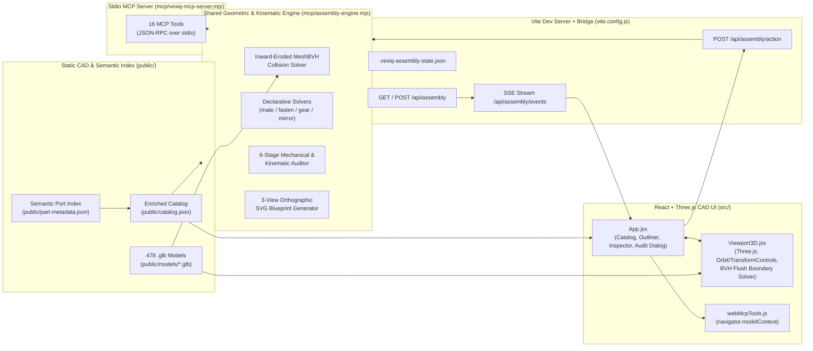

# VEX IQ 3D Robot Modeler — Architecture & Detailed Design (`design.md`)

> **Last Updated:** 2026-10-23  
> **Scope:** System architecture, coordinate conventions, data schemas, BVH collision & flush-boundary math, declarative mating solvers, 6-stage mechanical audit algorithms, and real-time MCP synchronization.

---

## 1. System Architecture Overview

The VEX IQ 3D Robot Modeler is a hybrid **Interactive 3D CAD Web Application** + **Headless Node.js Geometric Assembly Engine** that share a single source of truth for part geometry, semantic connection ports, and assembly state.

---

## 2. Directory & Module Structure

| Path | Responsibility |
| :--- | :--- |
| [`public/catalog.json`](file:///Users/adriangonsalves/projects/vexiq_builder/public/catalog.json) | Master catalog of 478 VEX IQ parts enriched with bounding boxes, `pitchSize`, `originType`, `gearSpecs`, `fastenerSpecs`, `mountingRules`, and `ports[]` (`4,137` verified semantic ports). |
| [`public/part-metadata.json`](file:///Users/adriangonsalves/projects/vexiq_builder/public/part-metadata.json) | Standalone semantic port & mechanical metadata index generated by the offline indexer. |
| [`public/models/*.glb`](file:///Users/adriangonsalves/projects/vexiq_builder/public/models) | Binary glTF 2.0 triangle meshes converted from official VEX IQ STEP files, centered at `[0, 0, 0]` in millimeters. |
| [`public/assembly-blueprint.svg`](file:///Users/adriangonsalves/projects/vexiq_builder/public/assembly-blueprint.svg) | Generated 3-view (`TOP X–Z`, `SIDE X–Y`, `FRONT Z–Y`) orthographic engineering blueprint. |
| [`scripts/build-catalog.mjs`](file:///Users/adriangonsalves/projects/vexiq_builder/scripts/build-catalog.mjs) | STEP + GLB ingestion script that extracts bounding boxes, cylindrical hole axes, and categories. |
| [`scripts/index-part-metadata.mjs`](file:///Users/adriangonsalves/projects/vexiq_builder/scripts/index-part-metadata.mjs) | 478-part BVH raycast & cross-section analyzer that classifies ports (`pin_hole`, `shaft_bore`, `shaft_socket`, `pin_peg`) and fastener/gear specs. |
| [`mcp/assembly-engine.mjs`](file:///Users/adriangonsalves/projects/vexiq_builder/mcp/assembly-engine.mjs) | Core geometric engine: MeshBVH collision checking, `mateParts`, `autoFastenJoint`, `meshGearTrain`, `mirrorSubassembly`, 6-stage `auditAssembly`, and `generateOrthographicViews`. |
| [`mcp/vexiq-mcp-server.mjs`](file:///Users/adriangonsalves/projects/vexiq_builder/mcp/vexiq-mcp-server.mjs) | Model Context Protocol (MCP) stdio server exposing 16 tools to AI coding/design agents. |
| [`vite.config.js`](file:///Users/adriangonsalves/projects/vexiq_builder/vite.config.js) | Custom Vite plugin `vexIqMcpBridgePlugin()` providing `/api/assembly`, `/api/assembly/events` (SSE), and `/api/assembly/action`. |
| [`src/App.jsx`](file:///Users/adriangonsalves/projects/vexiq_builder/src/App.jsx) | Main 3-column CAD UI: Part Library, 3D Viewport container & HUD, Scene Outliner, Precision Inspector, Smart Assembly card, and Audit & Blueprint `<dialog>`. |
| [`src/components/Viewport3D.jsx`](file:///Users/adriangonsalves/projects/vexiq_builder/src/components/Viewport3D.jsx) | Three.js WebGL scene, `OrbitControls`, `TransformControls`, BVH Flush Contact Boundary solver, Explode View engine, and Semantic Port 3D overlays. |
| [`src/utils/geometryCache.js`](file:///Users/adriangonsalves/projects/vexiq_builder/src/utils/geometryCache.js) | Singleton `.glb` loader and inward-eroded (`0.38 mm`) `MeshBVH` builder shared across viewport instances and thumbnails. |
| [`src/components/PartThumbnail.jsx`](file:///Users/adriangonsalves/projects/vexiq_builder/src/components/PartThumbnail.jsx) | Shared offscreen WebGL renderer that rasterizes and caches 2D data-URL thumbnails for catalog cards. |
| [`src/utils/webMcpTools.js`](file:///Users/adriangonsalves/projects/vexiq_builder/src/utils/webMcpTools.js) | W3C WebMCP (`navigator.modelContext`) tool registration for in-browser AI agents. |

---

## 3. Coordinate System & VEX Pitch Conventions

1. **Units & Pitch Constant:**
   - All 3D coordinates are stored in **millimeters (`mm`)**.
   - **1x VEX IQ Pitch (`1P`)** = $0.5\text{ in} = 12.7\text{ mm}$.
   - **0.5x Pitch (`0.5P`)** = $6.35\text{ mm}$ (standard thickness of a `1x` beam/plate wall and spacing from beam centerline to hole row).
   - **0.25x Pitch (`0.25P`)** = $3.175\text{ mm}$ (half-wall thickness from the center plane of a standard beam/plate to its outer mounting face).
2. **Part Local Coordinate Frame:**
   - Every `.glb` mesh in `public/models/` has its bounding-box center normalized to local origin `[0, 0, 0]`.
   - Standard structural beams lie along the **local `X` axis** (length), with hole rows along **local `Y`** ($\pm 6.35\text{ mm}$ for `2x` beams) and pin hole axes pointing along **local `Z`** (`[0, 0, 1]`, wall spanning $z \in [-3.05, +3.05]\text{ mm}$).
   - Standard pins, standoffs, shafts, gears, and wheels have their primary rotational/insertion axis along **local `Z`** (`[0, 0, 1]`).
3. **World Transform Composition:**
   - Each placed instance stores `position: [x, y, z]` (in `mm`) and intrinsic Euler `rotation: [rx, ry, rz]` (in degrees, order `'XYZ'`).
   - World matrix:
     $$M_{\text{world}} = T(x, y, z) \cdot R_X(r_x) \cdot R_Y(r_y) \cdot R_Z(r_z)$$

---

## 4. Semantic Port Indexing Pipeline ([`scripts/index-part-metadata.mjs`](file:///Users/adriangonsalves/projects/vexiq_builder/scripts/index-part-metadata.mjs))

During offline indexing across all 478 `.glb` + `.step` files:

1. **Candidate Axis Extraction:**
   - Parses STEP `CYLINDRICAL_SURFACE` entities (`AXIS2_PLACEMENT_3D` + radius) and deduplicates coaxial cylinders into candidate axes.
   - Synthesizes fallback grid axes for square-bore gears, wheels, motors, and plates whose bores are represented by planar/B-spline faces in STEP.
2. **BVH Raycast & Radial Cross-Section Classification:**
   - Casts axial rays along each candidate axis and 16 radial rays perpendicular to the axis against the `MeshBVH` of the part:
     - **`pin_hole`**: Open axial bore with radial wall hits at $r \in [2.1, 2.6]\text{ mm}$ ($\varnothing 4.8\text{ mm}$ VEX pin hole). Records exact wall entry/exit `spanMm: [tMin, tMax]` and `through: boolean`.
     - **`shaft_bore`**: Square or round bore on gears, wheels, sprockets, pulleys, and collars with minimum wall radius $r \in [1.4, 2.3]\text{ mm}$.
     - **`shaft_socket`**: Blind square drive socket on Smart Motors and electronics (`through: false`, depth $\approx 9.5\text{ mm}$).
     - **`pin_peg`**: External cylindrical peg on Connector Pins and Standoffs. Measures radial cross-sections along local $Z$ to locate the central retention flange (`shoulderZ`) or end cap (`hasEndCap`), storing `sideNegZ_mm` and `sidePosZ_mm` in `fastenerSpecs`.

---

## 5. Concave BVH Collision & Physical Flush Contact Boundary Solver

### 5.1 Inward-Eroded Collision Geometry (`clearanceMm = 0.38 mm`)
VEX IQ connector pins have snap ridges ($r \approx 2.35\text{ mm}$) that interference-fit inside beam holes ($r \approx 2.10\text{–}2.40\text{ mm}$), and meshed gears have slight tooth-tip tolerances. To allow valid pin-in-hole and gear-mesh engagements while catching real solid-body collisions:
- Both [`src/utils/geometryCache.js`](file:///Users/adriangonsalves/projects/vexiq_builder/src/utils/geometryCache.js) (browser) and [`mcp/assembly-engine.mjs`](file:///Users/adriangonsalves/projects/vexiq_builder/mcp/assembly-engine.mjs) (Node) weld vertex normals by spatial hash (`0.01 mm` tolerance) and erode every vertex inward by $\delta = 0.38\text{ mm}$:
  $$\mathbf{v}_{\text{col}} = \mathbf{v} - 0.38 \cdot \hat{\mathbf{n}}_{\text{welded}}$$
- A `MeshBVH` acceleration tree is built on the eroded geometry, and pairwise intersections are tested via `boundsTreeA.intersectsGeometry(geoB, M_BtoA)` after a fast world AABB broadphase check.

### 5.2 Physical Flush Contact Boundary Snapping ([`Viewport3D.jsx`](file:///Users/adriangonsalves/projects/vexiq_builder/src/components/Viewport3D.jsx))
When moving a part via the 3D Move Gizmo or Inspector Nudge buttons:
- Why standard `0.5P` (`6.35 mm`) grid steps fail at plate boundaries:
  - A beam centered at $z = 0$ has its hole boss at $\pm 2.29\text{ mm}$ and outer rim at $\pm 3.05\text{ mm}$.
  - A `0x2 Connector Pin` (`228-2500-086`) has its flat cap underside at $5.46\text{ mm}$ from its origin and cap outer face at $6.26\text{ mm}$.
  - Therefore, the pin's flat cap is **100% flush** with the beam when the pin is at:
    $$z_{\text{flush}} = \pm(5.46 - 2.287) \approx \pm 3.175\text{ mm} = \pm 0.25\text{P}$$
  - Moving in `0.5P` (`6.35 mm`) increments from $0\text{ mm}$ jumps straight to $\pm 6.35\text{ mm}$ (burying the cap inside the beam wall).
- **Flush Contact Detent Algorithm (`findFlushBoundaryPosition`):**
  1. During translation, `TransformControls` raw unsnapped cursor positions $\mathbf{p}_{\text{raw}}$ are evaluated in `objectChange`.
  2. In open space, coordinates snap to world grid multiples of `snapPitchFactor * 12.7 mm`.
  3. **Quarter-Pitch (`0.25P = 3.175 mm`) Flush Seat Detection:** If the cursor is near a `0.25P` plane $q$ where the part is collision-free (`checkGroupCollision === false`) AND stepping one `0.25P` further ($q \pm 3.175\text{ mm}$) causes a collision, $q$ is recognized as a physical flush seat and snapped to directly.
  4. **10-Step BVH Bisection on Penetration:** Whenever a snapped step $\mathbf{p}_{\text{snapped}}$ collides with another part while the previous drag pose $\mathbf{p}_{\text{clear}}$ was clear (and cursor penetration distance $\le 1.35\text{P} = 17.15\text{ mm}$):
     - A 10-iteration binary search on $[\mathbf{p}_{\text{clear}}, \mathbf{p}_{\text{snapped}}]$ locates the exact non-penetrating surface boundary $\mathbf{p}_{\text{lo}}$ to within $0.006\text{ mm}$.
     - If a clean `0.25P` (`3.175 mm`) grid plane lies on the safe side within $0.95\text{ mm}$ of $\mathbf{p}_{\text{lo}}$ and is collision-free, it snaps to that exact `0.25P` coordinate; otherwise it clamps to $\mathbf{p}_{\text{lo}}$.
     - Pulling the cursor further than $1.35\text{P}$ (or out the other side into clear space) releases the detent so parts can pass through when intended.

---

## 6. Declarative Mechanical Mating Solvers ([`mcp/assembly-engine.mjs`](file:///Users/adriangonsalves/projects/vexiq_builder/mcp/assembly-engine.mjs))

### 6.1 Port-to-Port Mating (`mateParts`)
Given a `sourceInstance` + `sourcePort` $(\mathbf{o}_s, \hat{\mathbf{a}}_s)$ and a `targetInstance` + `targetPort` $(\mathbf{o}_t^{\text{world}}, \hat{\mathbf{a}}_t^{\text{world}})$:
1. Computes the shortest-arc quaternion $Q_{\text{align}}$ rotating $\hat{\mathbf{a}}_s$ to $\pm\hat{\mathbf{a}}_t^{\text{world}}$ (`flipAxis`), composed with axial roll $Q_{\text{roll}}(\theta_{\text{roll}})$ around $\hat{\mathbf{a}}_t^{\text{world}}$.
2. Computes world position so the two port origins coincide plus `axialOffsetMm` along $\hat{\mathbf{a}}_t^{\text{world}}$:
   $$\mathbf{p}_s^{\text{world}} = \mathbf{o}_t^{\text{world}} + d_{\text{axial}} \cdot \hat{\mathbf{a}}_t^{\text{world}} - Q_{\text{total}}(\mathbf{o}_s)$$
3. If `axialOffsetMm == 0` and the initial pose collides (e.g. a capped pin or asymmetric bracket), searches candidate axial seating offsets (`±3.175 mm`, `±6.35 mm`) and `180°` axis flip to find a zero-collision flush seat automatically.

### 6.2 Auto-Fastening Coaxial Holes (`autoFastenJoint`)
1. Collects all `pin_hole` world ports on `instanceA` and partner instance(s) `instanceB` (or all touching parts).
2. Matches hole pairs whose axes are parallel ($|\hat{\mathbf{a}}_A \cdot \hat{\mathbf{a}}_B| \ge 0.985$), whose origins are collinear within $1.2\text{ mm}$ perpendicular distance, and whose axial separation is $\le 22\text{ mm}$.
3. Rejects holes already occupied by an existing pin or shaft.
4. Computes total joint span along the hole axis to select between `1x1 Connector Pin` (`228-2500-060`, 2-layer `12.7 mm` joint) and `1x2` / `0x3 Connector Pin` (3-layer joint), testing candidate shoulder seating depths via `checkCandidateCollision`.

### 6.3 Phase-Synchronized Gear Train Solver (`meshGearTrain`)
1. Places each gear in the sequence (`12T`, `24T`, `36T`, `48T`, `60T`) along the support beam's hole row, stepping along the beam by:
   $$\Delta X_i = R_{\text{pitch}}(g_{i-1}) + R_{\text{pitch}}(g_i) = \frac{N_{i-1} + N_i}{24} \times 12.7\text{ mm}$$
2. Alternates axial roll angle on every odd-indexed gear by half a tooth pitch:
   $$\theta_{\text{roll}, i} = \begin{cases} 0^\circ & i \text{ even} \\ \frac{180^\circ}{N_i} & i \text{ odd} \end{cases}$$
   (e.g. $5^\circ$ for a `36T` gear), ensuring tooth tips interleave into mating root valleys with zero BVH collision.

### 6.4 BVH-Compensated Symmetry Mirror (`mirrorSubassembly`)
1. Reflects part positions across `X = planeOffsetMm` or `Z = planeOffsetMm` and reflects the rotation matrix $R' = S \cdot R \cdot S$ (with handedness correction so $\det(R') = +1$).
2. Tests the mirrored instance with `checkCandidateCollision`; if an asymmetric part (e.g. Smart Motor, capped pin, corner connector) collides after pure reflection, searches $180^\circ$ roll/yaw compensations and $\pm 0.25\text{P}$ axial shifts to seat it cleanly.

---

## 7. 6-Stage Mechanical & Kinematic Audit ([`auditAssembly`](file:///Users/adriangonsalves/projects/vexiq_builder/mcp/assembly-engine.mjs#L388-L809))

`auditAssembly()` evaluates six physical criteria:
1. **Stage 1 (Solid Collisions):** Runs `checkCandidateCollision` across all visible instances.
2. **Stage 2 (Fastener Engagement):** Projects every structural `pin_hole`, `shaft_bore`, and `shaft_socket` onto each fastener's world line segment $[-\frac{L}{2}, +\frac{L}{2}]$. A Connector Pin must engage $\ge 2$ distinct structural parts; a Shaft must engage $\ge 1$ part.
3. **Stage 3 (Unsecured & Heavy Parts):** Counts fastener engagements per non-fastener part and compares against `part.mountingRules.minFastenersRequired` (`2` for Brain/Motor/Battery, `1` for standard parts).
4. **Stage 4 (Connectivity Graph):** Builds an undirected graph where edges represent shared fasteners, coaxial mated ports, meshed gears, or flush touching bounding boxes, then runs BFS to count connected components and flag isolated islands.
5. **Stage 5 (Shaft Protrusions):** Computes the axial projection interval of all engaged parts along each shaft and flags overhangs $> 8.0\text{ mm}$ beyond the outermost wheel/frame.
6. **Stage 6 (Kinematic Drivetrain):** Builds a directed power graph from each `Smart Motor`'s `shaft_socket` $\rightarrow$ engaged `Shaft` $\rightarrow$ coaxial `Gear` (`shaft_bore`) $\rightarrow$ pitch-circle tangent `Gear` ($\|\Delta \mathbf{p}_\perp - (R_1 + R_2)\| \le 2.2\text{ mm}$) $\rightarrow$ `Wheel`, reporting `drivenWheelCount / totalWheelCount`.

---

## 8. Real-Time Bi-Directional Synchronization (`vite.config.js`)

- **File-Backed Shared State (`.vexiq-assembly-state.json`):**
  - Both the Vite dev server and the stdio MCP process read/write `.vexiq-assembly-state.json`.
- **Server-Sent Events (`/api/assembly/events`):**
  - When an MCP tool mutates the assembly, `writeAssemblyState()` POSTs to `http://localhost:5173/api/assembly` with header `x-mcp-source: mcp-server`.
  - Vite broadcasts the updated state to all connected browser tabs via SSE (`es.onmessage`), updating the 3D scene immediately without page reload.
- **Manual UI Smart Actions (`POST /api/assembly/action`):**
  - When the user clicks **Auto-Fasten**, **Snap & Mate**, **Build Meshed Gear Train**, **Mirror**, or **Audit & Blueprint** in the React UI, [`src/App.jsx`](file:///Users/adriangonsalves/projects/vexiq_builder/src/App.jsx) sends the current browser state + action payload to `/api/assembly/action`, which executes the exact same `mcp/assembly-engine.mjs` solver and returns the updated state and audit/blueprint artifacts.
